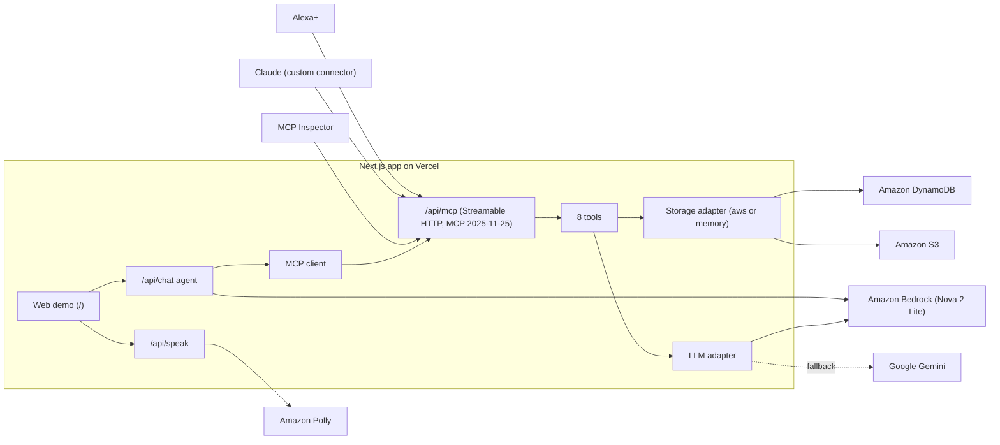

# Duly

**Paperwork, duly handled.**

Duly is a remote MCP server that turns Alexa+ into a household paperwork manager. Give it a bill, a letter or a warranty and it remembers every deadline, explains the fine print in plain language and drafts replies, with short answers meant to be spoken. It runs on AWS (Amazon Bedrock, DynamoDB, S3 and Polly) and ships with fictional sample documents only.

## Try it

| | |
|---|---|
| **MCP endpoint** (Streamable HTTP, no sign-in) | `https://duly-home.vercel.app/api/mcp` |
| **Web demo** (Echo Show-style web demo that runs in any browser) | https://duly-home.vercel.app |

The web demo simulates how Alexa+ would use Duly; it does not run on a real Echo Show device. Press the mic (Chrome or Edge) or type a question, or tap a suggestion chip.

**Add Duly to Claude as a custom connector**

1. In Claude, go to **Customize > Connectors**, click **+ Add**, then **Add custom connector**.
2. Name it `Duly`, paste `https://duly-home.vercel.app/api/mcp` and click **Continue**.
3. Under **Authentication**, choose **No sign in**, then click **Add**.
4. In a chat, click **+** at the lower left, open **Connectors** and turn on **Duly**.

Then ask: "What do I need to pay this month?", "Is my dishwasher still under warranty?", "Is my Brightwave bill higher than usual?" or "Write a polite email to Brightwave Energy asking for a two-week payment extension."

### MCP Inspector

1. Run `npx @modelcontextprotocol/inspector` (it opens in your browser).
2. Set **Transport Type** to `Streamable HTTP` and **URL** to `https://duly-home.vercel.app/api/mcp`.
3. Click **Connect**, open **Tools**, click **List Tools** and run any tool, for example `list_deadlines` with no arguments or `check_warranty` with `product: "dishwasher"`.

The production server holds one shared demo household. To call every tool from a terminal (including `add_document`, which saves a new document), use a local server instead: see [Check that it works](#check-that-it-works).

## Architecture



- **MCP server** ([`app/api/mcp/route.ts`](app/api/mcp/route.ts)): `mcp-handler` + the official MCP TypeScript SDK, stateless Streamable HTTP. Every tool returns a short spoken sentence plus `structuredContent` with the full data for screens. Requests are rate-limited per IP.
- **Storage adapter** ([`lib/storage/`](lib/storage/)): `STORAGE=aws` (DynamoDB + S3) or `STORAGE=memory` (in-process, seeded with the sample documents).
- **LLM adapter** ([`lib/llm/`](lib/llm/)): `LLM_PROVIDER=bedrock` or `gemini`, with an optional `LLM_FALLBACK`.
- **Web demo**: [`app/api/chat/route.ts`](app/api/chat/route.ts) runs a Bedrock Converse agent ([`lib/agent/agent.ts`](lib/agent/agent.ts)) that is an **MCP client of Duly's own `/api/mcp`** ([`lib/agent/mcpClient.ts`](lib/agent/mcpClient.ts)): it lists the tools over MCP, lets the model pick one and calls it over MCP, the same way Alexa+ would.

## Tools

| Tool | What it does | Example question | LLM |
|---|---|---|---|
| `add_document` | Saves a bill, letter, warranty... from text or a photo/PDF (base64, max 3 MB) and extracts type, issuer, amounts, deadlines and action items. | "Save this letter." | yes |
| `list_deadlines` | Upcoming deadlines sorted by date, with amounts and days left (default: next 30 days). `payable: true` returns everything with an amount to pay. | "What do I need to pay this month?" | no |
| `explain_document` | Plain-language explanation, what happens if it's ignored and the recommended next step. Finds the document itself from keywords or the sender. | "What happens if I ignore the parking notice?" | yes |
| `check_warranty` | One product's warranty (end date, days left, how to claim), or every warranty with its status: active, expiring soon or expired. | "Is my dishwasher still under warranty?" | no |
| `draft_reply` | Short letter or email replying to a document, using its real numbers and dates (tone `polite` or `firm`). | "Ask Brightwave Energy for a payment extension." | yes |
| `search_documents` | Finds stored documents by keywords (id, title, issuer, type). | "When does the car insurance renew?" | no |
| `compare_bills` | Latest bill from a company vs the previous one and vs the usual (average) amount, with percentages. When the bills store usage in the same unit (kWh, gallons), it also tells "you used more" apart from "the price per unit went up". Only states the numbers, never a reason. | "Is my electricity bill higher than usual?" | no |
| `weekly_brief` | The next 7 days (or `days`), most urgent first: deadlines with amounts, renewals you can still cancel, warranties ending within 60 days and bills at least 15% above usual. | "Give me my weekly brief." | no |

When a company has several bills, search, explanations and drafts always use the latest one. Duly explains documents; it does not give legal or financial advice.

### Sample data

14 fictional documents (marked SAMPLE): an electricity bill, a car insurance renewal, a dishwasher receipt with warranty, a parking notice, a gym auto-renewal and a school field-trip form, plus four more warranties (a TV, a fridge that is about to run out, an expired washing machine and a laptop) and two earlier electricity and water bills each, so bills can be compared (the electricity bills also store their kWh usage). All dates are relative to today, so deadlines are always upcoming; the earlier bills are already paid and never show up as deadlines.

### More

- [`skills/duly/SKILL.md`](skills/duly/SKILL.md): Agent Skill that tells any agent when and how to use the Duly tools.
- [`FRICTION.md`](FRICTION.md): friction log of the problems we hit with AWS and MCP tools.
- [`samples/README.md`](samples/README.md): the sample documents (PNG/PDF) and the expected extraction for each one.

## Built with AWS

Duly runs on AWS when `STORAGE=aws` and `LLM_PROVIDER=bedrock` (region `eu-west-1`).

| AWS service | What it does in Duly | Files |
|---|---|---|
| **Amazon Bedrock** (Converse API, **Amazon Nova 2 Lite** via the EU cross-region inference profile `eu.amazon.nova-2-lite-v1:0`) | Reads photos (PNG/JPEG) and PDFs of household paperwork and extracts type, issuer, amounts, deadlines and action items as validated JSON (`add_document`). Writes plain-language explanations (`explain_document`) and reply drafts (`draft_reply`). Uses a forced tool call so the answer always matches the zod schema. In the web demo, it is also the agent that picks which Duly MCP tool to call (Converse tool use). | [`lib/llm/bedrock.ts`](lib/llm/bedrock.ts), [`lib/llm/index.ts`](lib/llm/index.ts), [`lib/llm/fallback.ts`](lib/llm/fallback.ts), [`lib/agent/agent.ts`](lib/agent/agent.ts) |
| **Amazon DynamoDB** (on-demand table `duly`, keys `pk = HOUSEHOLD#<id>`, `sk = DOC#<id>`) | Stores every document and its deadlines. All tools read from it. | [`lib/storage/aws.ts`](lib/storage/aws.ts), [`lib/aws.ts`](lib/aws.ts) |
| **Amazon S3** (private bucket `duly-devcaos-files`, all public access blocked) | Keeps the original uploaded file of each document (`households/<id>/<doc-id>.pdf`); its key is saved in `Document.fileKey`. | [`lib/storage/aws.ts`](lib/storage/aws.ts), [`lib/tools/addDocument.ts`](lib/tools/addDocument.ts) |
| **Amazon Polly** (neural voice, `Joanna` en-US by default, `POLLY_VOICE_ID` to change it) | Speaks the web demo's replies (MP3). If Polly fails, the page falls back to the browser's `speechSynthesis`. | [`app/api/speak/route.ts`](app/api/speak/route.ts), [`components/echo/voice.ts`](components/echo/voice.ts) |

Setup scripts (AWS SDK for JavaScript v3):

- [`scripts/setup-aws.ts`](scripts/setup-aws.ts): `npm run setup:aws` creates the DynamoDB table and the private S3 bucket. Safe to run again.
- [`scripts/seed-aws.ts`](scripts/seed-aws.ts): `npm run seed:aws` resets the demo household to the sample documents ([`lib/storage/seed.ts`](lib/storage/seed.ts)), with dates relative to today.

If Bedrock is throttled, temporarily unavailable or times out, `LLM_FALLBACK=gemini` retries the same request with Google Gemini, and the server log says which provider answered (`[llm] answered by bedrock`). The fallback is **not** used for `AccessDenied`, validation or other client errors: those mean the AWS setup is wrong, so Duly logs `AWS is misconfigured` and returns a generic error. Logs only contain the error name, HTTP status and a short message (ARNs, account IDs and request IDs are masked), and tool callers never see configuration details.

### IAM permissions (least privilege)

[`docs/iam-policy.json`](docs/iam-policy.json) is the exact policy of the IAM user that Duly runs with. Replace `ACCOUNT_ID` with your AWS account ID.

| Statement | Allows | Used by |
|---|---|---|
| `BedrockInvokeNova2Lite` | `InvokeModel` / `InvokeModelWithResponseStream` on Nova 2 Lite: the `eu` inference profile in `eu-west-1` and the foundation model in the EU regions that profile routes to | `lib/llm/bedrock.ts`, `lib/agent/agent.ts` |
| `DynamoDbDulyTable` | Item access (`GetItem`, `PutItem`, `UpdateItem`, `DeleteItem`, `Query`, `Scan`) and `DescribeTable` on the `duly` table only | `lib/storage/aws.ts`, `scripts/seed-aws.ts` |
| `S3DulyBucket` / `S3DulyObjects` | `PutObject` / `GetObject` on the objects of `duly-devcaos-files`, plus bucket-level `ListBucket` and `GetBucketLocation` | `lib/storage/aws.ts` |
| `PollySpeech` | `SynthesizeSpeech` (Polly has no resource-level permissions, so `Resource` is `*`) | `app/api/speak/route.ts` |

Three actions are only needed by `npm run setup:aws`: **`dynamodb:CreateTable`**, **`s3:CreateBucket`** and **`s3:PutBucketPublicAccessBlock`**. After the table and bucket exist you can remove them from the policy; the running server and `npm run seed:aws` don't use them.

> **The bucket must stay private.** `setup:aws` blocks all public access on every run. Never add a bucket policy, ACL or CloudFront rule that makes `duly-devcaos-files` public: it holds the original documents people upload.

## Run it locally

Commands are the same on macOS, Linux and Windows; the npm scripts set no environment variables inline. Where a command sets a variable for one run, both the bash (macOS/Linux) and PowerShell (Windows) forms are shown.

### 1. Install

Prerequisites: [Node.js](https://nodejs.org) **20.12 or later** (with npm) and Git.

```bash
git clone https://github.com/devcaos/duly.git
cd duly
npm install
```

### 2. Configure

Copy [`.env.example`](.env.example) to `.env.local` and fill in what you need (never commit `.env.local`):

```bash
cp .env.example .env.local            # macOS / Linux
Copy-Item .env.example .env.local     # Windows PowerShell
```

What works with which settings:

| Settings in `.env.local` | What works |
|---|---|
| Nothing (defaults: `STORAGE=memory`, `LLM_PROVIDER=gemini`) | `npm run test:unit`; the MCP server with the sample documents; the tools that don't use an LLM (`list_deadlines`, `check_warranty`, `search_documents`, `compare_bills`, `weekly_brief`); the web demo's "Coming up" list. |
| + `GEMINI_API_KEY` | Also `add_document`, `explain_document` and `draft_reply`. |
| + `AWS_REGION`, `AWS_ACCESS_KEY_ID`, `AWS_SECRET_ACCESS_KEY` (IAM user with the [policy above](#iam-permissions-least-privilege)) | Bedrock (`LLM_PROVIDER=bedrock`), DynamoDB + S3 (`STORAGE=aws`, after `setup:aws` and `seed:aws`), Polly, and the web demo's questions (the `/api/chat` agent always uses Bedrock). |
| `npm run mock:aws` (no AWS account) | The web demo with canned answers, see [Test the web demo without AWS](#test-the-web-demo-without-aws). |

With `STORAGE=memory`, documents you add can disappear when the server restarts; the sample documents always come back.

### 3. Set up AWS (optional)

Only with AWS credentials in `.env.local`:

```bash
npm run setup:aws    # creates the DynamoDB table and the private S3 bucket
npm run seed:aws     # resets the demo household to the sample documents
```

Then set `STORAGE=aws`, `LLM_PROVIDER=bedrock` (and optionally `LLM_FALLBACK=gemini`) in `.env.local`.

### 4. Start

```bash
npm run dev
```

Open http://localhost:3000 for the web demo; the MCP endpoint is http://localhost:3000/api/mcp.

### Check that it works

```bash
npm run test:unit
```

Unit tests, no server and no keys needed.

`npm run tools` ([`scripts/call-tools.mjs`](scripts/call-tools.mjs)) calls every tool against a running server, **including `add_document`, which saves a new document**. Run it against a local server with in-memory storage, so it never writes into a real table. Start the server in one terminal:

```bash
STORAGE=memory npm run dev            # macOS / Linux
$env:STORAGE="memory"; npm run dev    # Windows PowerShell
```

Then, in another terminal:

```bash
npm run tools                                         # text-only calls
npm run tools -- samples/07-riverside-water-bill.pdf  # also add_document with a PDF
```

A variable set in the shell wins over `.env.local`, so this works even if `.env.local` says `STORAGE=aws`. The LLM tools need `GEMINI_API_KEY` or AWS credentials.

`npm run smoke:bedrock` ([`scripts/smoke-bedrock.mjs`](scripts/smoke-bedrock.mjs)) sends the demo questions to `/api/chat` (Bedrock needed), one by one and as a conversation. It only asks questions and never saves documents. For each one it prints the tool chosen, the route (`model`: Nova picked it; `forced-keyword` / `forced-any`: asked again, requiring a tool; `server-default`: the server called the tool itself) and the spoken reply. Pass a base URL to test a deployment:

```bash
npm run smoke:bedrock -- https://duly-home.vercel.app
```

### Test the web demo without AWS

[`scripts/mock-aws.mjs`](scripts/mock-aws.mjs) is a local stand-in for Bedrock and Polly with canned, keyword-based answers. The app code doesn't change: the AWS SDK sends its requests to the mock because of the `AWS_ENDPOINT_URL_*` variables.

1. In one terminal: `npm run mock:aws`.
2. In `.env.local`, set `LLM_PROVIDER=bedrock`, `AWS_ACCESS_KEY_ID=mock`, `AWS_SECRET_ACCESS_KEY=mock`, `AWS_ENDPOINT_URL_BEDROCK_RUNTIME=http://localhost:4010` and `AWS_ENDPOINT_URL_POLLY=http://localhost:4010` (and `STORAGE=memory`).
3. In another terminal: `npm run dev`, then open http://localhost:3000.

Like real Bedrock, the mock answers in text when a tool result in the history mixes text and JSON (see FRICTION.md). Test hooks in the mock: put `[text-first]` in a question to make the model answer in text first (tests the forced-tool retry), `[text-always]` to answer in text even when a tool is required, `[bad-input]` to send arguments the server rejects (both test the server-side default call), `[search-only]` to make it call only `search_documents` (tests the explain fallback), and `[bad-draft]` / `[bad-draft-twice]` in a `draft_reply` intent to test the letter validator's retry and the template letter.

The mock Polly plays a short chime instead of speech. To test the browser voice fallback, start it with:

```bash
MOCK_POLLY=fail npm run mock:aws               # macOS / Linux
$env:MOCK_POLLY="fail"; npm run mock:aws       # Windows PowerShell
```

Remove the `AWS_ENDPOINT_URL_*` lines to use real AWS.

## How the web demo works

- Press the **mic** and ask a question (Web Speech API, `en-US`, Chrome or Edge), or **type** it. The suggestion chips run the demo questions.
- **Add document** uploads a photo or PDF (JPEG, PNG or PDF, max 3 MB) and saves it with `add_document`.
- The reply is spoken with **Amazon Polly** (neural voice). If Polly is unavailable, the browser's own voice reads it.
- The screen shows result cards: deadlines, the saved document, the warranty, or a letter draft with **Copy** and **Make it firmer**.

What the assistant says is the tool's own spoken sentence; the model never writes the reply, so it can't leak ids or JSON or claim actions it didn't take. If the model answers with text instead of choosing a tool, the app asks once more with `toolChoice: any` (a tool call is required) before giving a help sentence. A safety filter ([`lib/speech.ts`](lib/speech.ts)) still removes ids and JSON and turns ISO dates into spoken dates. The home screen's "Coming up" list, uploads and the **Make it firmer** button call `list_deadlines`, `add_document` and `draft_reply` directly, without the model (a model can't copy a whole file into a tool call). Set `MCP_URL` to point the app at another Duly server.

## Deploy to Vercel

1. Import the repository in Vercel (framework preset: Next.js; no build settings to change).
2. In **Settings > Environment Variables**, add the variables from [`.env.example`](.env.example) for each environment (Production, Preview). For the AWS setup: `STORAGE=aws`, `LLM_PROVIDER=bedrock`, `LLM_FALLBACK=gemini`, `AWS_REGION`, `AWS_ACCESS_KEY_ID`, `AWS_SECRET_ACCESS_KEY`, `BEDROCK_MODEL_ID`, `DYNAMODB_TABLE`, `S3_BUCKET`, `POLLY_VOICE_ID`, `GEMINI_API_KEY`, `GEMINI_MODEL` and `DULY_INTERNAL_TOKEN` (a different random value per environment). Leave `MCP_URL` and the `AWS_ENDPOINT_URL_*` variables unset.
3. Deploy, then check it with `npm run smoke:bedrock -- https://<your-deployment>.vercel.app`.

Rate limits: `/api/mcp`, `/api/chat` and `/api/speak` limit each client by IP (`RATE_LIMIT_PER_MIN` for requests and `LLM_RATE_LIMIT_PER_MIN` for LLM calls on `/api/mcp` and `/api/chat`; `/api/speak` has its own fixed limit). `DULY_INTERNAL_TOKEN` lets the web demo's own calls to `/api/mcp` skip the per-IP limit there; without it, every visitor shares the server's IP bucket on `/api/mcp`. The token is only sent when the MCP URL's host is this deployment's own (`VERCEL_URL`, `VERCEL_BRANCH_URL` or `VERCEL_PROJECT_PRODUCTION_URL`) or `localhost`, so setting `MCP_URL` never sends the secret to another server. The in-memory limiter tracks at most 10,000 keys; when it is full, expired keys go first and then the oldest.

## Known limitations

- Explanations are grounded by prompt rules (the model is told to use only the document's own facts), not by a full fact validator.
- No sign-in: one demo household with fictional data only. Don't upload real documents to the public deployment.
- Rate limits are in memory, per server instance.

## License

[MIT](LICENSE)
